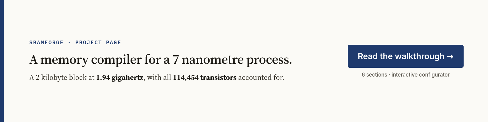
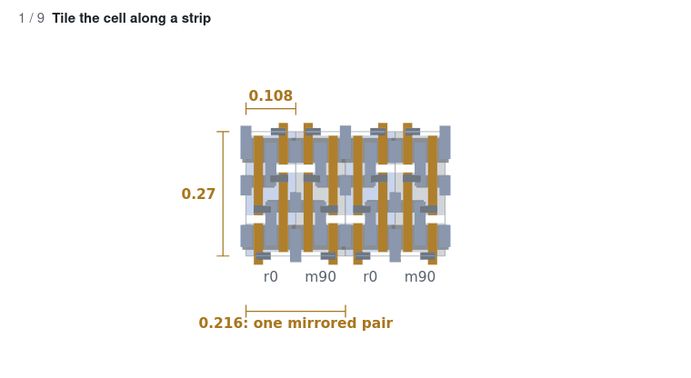
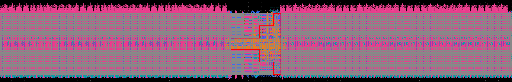

# sramforge

[](https://github.com/Samcooper01/Open-SRAM-Compiler-ASAP7nmPDK/actions/workflows/verify.yml)

**A memory compiler for a 7 nanometre process, built with open-source tools only.**

`sramforge` generates SRAM (Static Random-Access Memory) blocks from 1 to 8 kilobytes:
the full transistor-level layout, plus the abstract, timing library and behavioural
model. It comes with its own verification stack, which checks each block from every
shape in place to data stored in time.

<p align="center">
  <a href="https://samcooper01.github.io/Open-SRAM-Compiler-ASAP7nmPDK/"></a>
  <br>
  <b><a href="https://samcooper01.github.io/Open-SRAM-Compiler-ASAP7nmPDK/">&#8594; Read the full walkthrough</a></b>
</p>

Every chip needs memory, and memory is not written in a hardware description
language like the rest of a design. It is drawn. A memory compiler takes the size you
want and assembles the transistor-level layout. Those compilers are normally
supplied by the foundry or bought, and closed. This one is written in Python for
[ASAP7 (Arizona State Predictive Process Design Kit, 7 nanometre)](https://github.com/The-OpenROAD-Project/asap7),
an open kit for a 7 nanometre process. It starts from the leaf cells in the kit's
[SRAM (Static Random-Access Memory) release](https://github.com/The-OpenROAD-Project/asap7_sram_0p0),
builds everything around them, and checks the result using only open tools:
[KLayout](https://www.klayout.de/), [OpenROAD](https://theopenroad.org/),
[ngspice](https://ngspice.sourceforge.io/) and [OpenVAF](https://openvaf.semimod.de/).

<p align="center">
  <picture>
    <source media="(prefers-color-scheme: dark)" srcset="docs/images/tiling-dark.gif">
    
  </picture>
</p>

*How the generator builds a block, to scale, with measured values in amber: one cell
tiled into strips and arrays, mirrored around the shared read and write column, and
stacked into the full block; then each of the three parameters changed in turn.*

## The project in brief

1. **A generator that replays measured rules.** The tiling rules were measured from
   the kit's own 2 kilobyte block. At that size the generated layout is identical to
   the kit's on all 31 layers, and the same rules build any size from 4 to 64 bits per
   group, 4 or 8 cell strips and 8 to 96 rows.
2. **A rebuilt control block.** The kit's control logic only fits sizes near the
   reference. For the others it is extracted from the layout, edited (a ninth address
   bit, a longer delay line, eight-strip column selects), and placed and routed again
   with OpenROAD.
3. **Four outputs from one list of pins.** The layout, the abstract a place-and-route
   tool needs, a timing library in the Liberty format, and a behavioural model in
   Verilog, all derived from the same pin list so they agree by construction.
4. **A verification stack written from scratch.** Seven questions, from whether every
   shape is in place to whether the block stores data in time, answered from the
   layout itself (see Verification below).

## Results



*The generated 2 kilobyte block, shown on its side: 16,384 memory cells in two
mirrored halves, with the decoder and control logic between them. It is 9.6 by 77.8
micrometres.*

Measured on that block: the area from its outline, the rest by simulating the
transistors extracted from it, at the typical corner.

| Property | Value | Meaning |
|---|---|---|
| Size | 747.9 square micrometres | 63.9 per cent of it is memory cells |
| Speed | 1.94 gigahertz | A 516 picosecond period: the 430 picoseconds confirmed in simulation, plus a fifth as margin |
| Read latency | 243 picoseconds | From the clock edge to data on the output pins |
| Read energy | 0.615 picojoules | Charge drawn from the supply for one access |
| Idle power | 773 nanowatts | Leakage while the block is idle |
| Cell stability | 154 millivolts | The noise a stored bit tolerates while being read, out of a 700 millivolt supply |

The largest block taken through the same measurements holds 65,536 memory cells.

## Verification

The block has never been made in silicon, so every answer comes from the generated
layout itself. Each question relies on the ones before it.

| Question | Answer for the 2 kilobyte block | Checked by |
|---|---|---|
| Is every shape where it should be? | Identical to the kit's own block on all 31 layers | [test_golden.py](tests/test_golden.py), [test_invariants.py](tests/test_invariants.py) |
| Is it wired the way it should be? | Every bit line, word line and supply is one unbroken wire, and no two touch | [test_connectivity.py](tests/test_connectivity.py) |
| Can it be manufactured? | Passes all 97 rules from the kit's rule manual | [test_drc.py](tests/test_drc.py) |
| Are the transistors the ones we meant? | All 114,454 extracted and accounted for; each cell matches the six-transistor schematic | [test_lvs.py](tests/test_lvs.py) |
| Does it store and return data? | Every address opens exactly the right cells, and bits written are read back | [test_functional.py](tests/test_functional.py), [writeread_sweep.py](scripts/access_sim/writeread_sweep.py) |
| Does it work in time? | The sense amplifier fires after its farthest cell is ready | [test_sense_timing.py](tests/test_sense_timing.py), [characterize.py](scripts/characterize.py) |
| Do the files a chip designer uses tell the truth? | The abstract matches the layout exactly, and every timing value traces to a measurement | [test_lef.py](tests/test_lef.py), [test_liberty.py](tests/test_liberty.py) |

Five of the checks are fed deliberately damaged layouts every time they run and must
reject them, and the rule and transistor checks agree with independently written
tools. The walkthrough states which other sizes each answer covers.

## How it works

1. **Tiling** ([tech.py](sramforge/tech.py), [generator.py](sramforge/generator.py)):
   memory cells form strips, strips form arrays, two mirrored arrays share a read and
   write column, and these column groups stack into two halves around a central band.
2. **Directly drawn wiring** ([overlays.json](sramforge/overlays.json)): the shapes the
   kit draws by hand at each level, kept as an explicit, labelled table.
3. **Control band** ([band.py](sramforge/band.py), [pnr/](pnr/)): the kit's control
   logic, or the rebuilt one placed and routed by OpenROAD.
4. **Sense timing** ([sense.py](sramforge/sense.py),
   [sae_codes.json](sramforge/sae_codes.json)): each size gets the delay setting that
   fires the sense amplifier after its farthest cell is ready.
5. **Outputs** ([pins.py](sramforge/pins.py), [lef.py](sramforge/lef.py),
   [liberty.py](sramforge/liberty.py), [verilog.py](sramforge/verilog.py)): the
   abstract, timing library and behavioural model, from one pin list.
6. **Checks** ([drc.py](sramforge/drc.py), [nets.py](sramforge/nets.py),
   [lvs.py](sramforge/lvs.py), [switchsim.py](sramforge/switchsim.py)): 97 design
   rules, wiring rebuilt from the raw shapes, transistors extracted and matched, and
   simulation of the extracted circuit.
7. **Measurement** ([characterize.py](scripts/characterize.py),
   [cell_margin.py](scripts/cell_margin.py)): transistor-level simulation of the
   extracted layout, written to the records in `out/`.

## Repository map

| Path | What |
|---|---|
| `sramforge/` | the compiler and its checks |
| `tests/` | the checks behind the seven questions; `tests/run_all.py` runs them all |
| `scripts/` | measurements, cell extraction, control-logic edits, and the project page |
| `pnr/`, `sta/` | placing and routing the rebuilt control, and timing the finished block, with OpenROAD |
| `spice/` | transistor models and circuit testbenches |
| `cells/` | the leaf cells, extracted from the kit's release |
| `out/` | the committed measurement records |
| `examples/` | a pre-built 2 kilobyte block |
| `docs/` | the project page, its images, and the design documents |

## Reproduce

Needs Python 3.10 or later and the KLayout Python module:

```bash
pip install klayout
python3 -m sramforge --out out/                         # the reference 2 kilobyte block
python3 -m sramforge --bits 16 --depth 64 --out out/ --lef
```

Each build writes the layout, the behavioural model and a manifest; `--lef` adds the
abstract. The checks compare against the kit's release, cloned beside this repository:

```bash
git clone https://github.com/The-OpenROAD-Project/asap7_sram_0p0.git ../asap7_sram_0p0
python3 tests/run_all.py
```

The checks that need only Python and KLayout run on every code change. The measurements need
ngspice with the kit's transistor models compiled by OpenVAF (`SRAMFORGE_NGSPICE` and
`SRAMFORGE_OSDI` point at them), and the timing run needs Docker with the
`openroad/orfs` image, so those run locally and their records are committed.

## Limitations

- The process kit is predictive, so nothing here has been built in silicon.
- The simulations leave out the resistance and capacitance of the wiring.
- Block area does not yet shrink with the configuration.
- Sizes other than the reference are held to recorded rule baselines rather than
  passing every rule, and only the reference has a timing library at all three corners.
- The behavioural model is not compared with the layout, and has no timing checks.

## Future work

1. Replica sense timing: a dummy far row that fires the sense amplifier itself.
2. Timing libraries for more sizes, and at the fast corner.
3. Clean rule checks for every size, plus antenna and density rules.
4. Bank-level wiring generated from rules rather than measured from the kit.
5. One command that runs every check on a newly generated block.

## Third-party material

The leaf cells in `cells/` come from the kit's SRAM (Static Random-Access Memory)
release, copyright 2023 The OpenROAD Project, and the transistor models in
`spice/models/` are converted from the ASAP7 (Arizona State Predictive Process Design
Kit, 7 nanometre) kit, copyright 2020 Lawrence T. Clark, Vinay Vashishtha, or Arizona
State University. Both are used under their owners' BSD (Berkeley Software
Distribution) 3-Clause licences, as credited in `NOTICE`.
